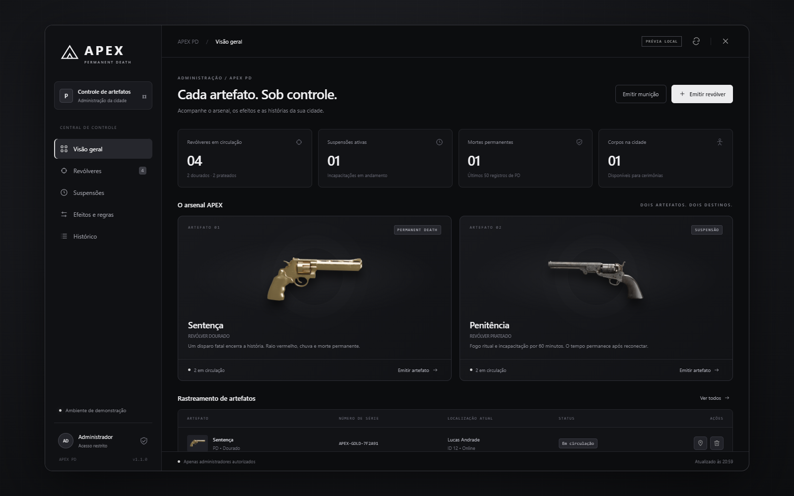
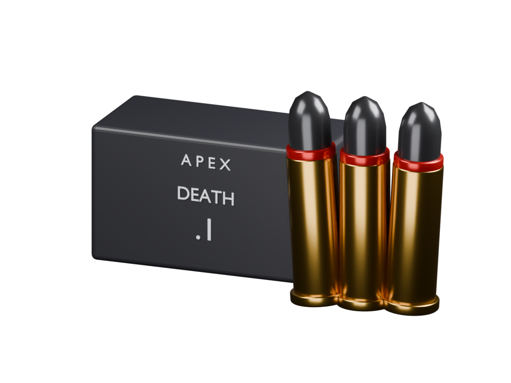
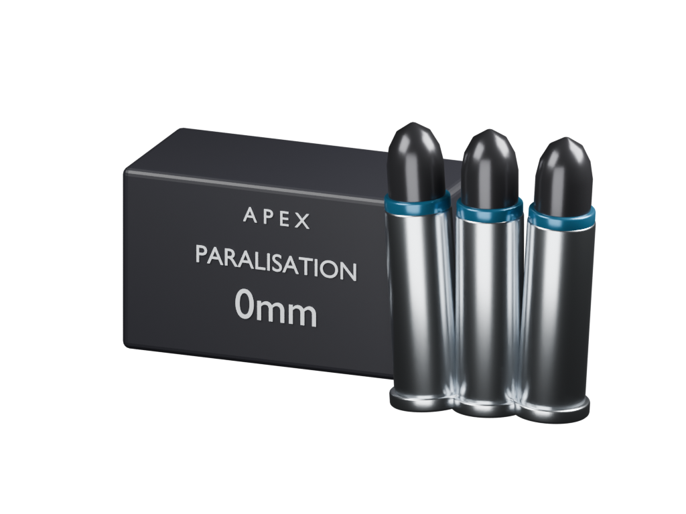

# Auren_Death · MRI QBOX

Revólveres especiais com morte permanente, paralisação persistente, efeitos sincronizados, munições exclusivas e painel administrativo. Versão **1.1.3**.



## Arsenal

| Artefato | Arma / item | Munição exclusiva | Resultado |
|---|---|---|---|
| Sentença · dourado | `WEAPON_REVOLVER` | `ammo-apex-death` · **Death .1** | Disparo fatal: raio vermelho na cabeça, chuva e PD |
| Penitência · prata | `WEAPON_NAVYREVOLVER` | `ammo-apex-paralisation` · **Paralisation 0mm** | Acerto: fogo visual e incapacitação por 60 minutos |




O dourado confirma a fatalidade antes de descarregar/desconectar o jogador e excluir aquele personagem pelo `citizenid`. Cria um ped independente com aparência da vítima, disponível para transporte e velórios até parar o resource ou reiniciar o servidor. Outros personagens e a conta/licença permanecem.

A prata salva o término absoluto da suspensão. NPCs e jogadores caem com a física relaxada do GTA e permanecem no chão, com aparência de mortos, durante a paralisia. A prata continua sendo uma incapacitação temporária de 60 minutos por padrão, sem WIPE. Reconectar não reinicia a contagem; o tempo offline conta. As chamas são partículas visuais, sem propagação de incêndio nem dano térmico. Duração, fogo, raio e chuva podem ser alterados pelo painel.

NPCs **sincronizados pelo OneSync** também recebem os efeitos: disparo fatal dourado gera raio/chuva; prata paralisa e produz fogo. NPCs não passam pelo fluxo de desconexão ou WIPE. O prazo de NPC é mantido em memória até expirar ou parar o resource. Peds exclusivamente locais de outros scripts precisam estar em rede para o servidor validar o acerto.

O dano local em um NPC controlado pelo atirador é detectado por `entityDamaged` e validado no servidor. O raio utiliza as coordenadas recebidas mesmo quando o corpo ainda não estiver no alcance de sincronização. Reinicie `Auren_Death` e reconecte os jogadores após atualizar os modelos.

O raio da dourada desce de 300 metros acima do impacto, com canal fractal irregular, oito bifurcações curvas, núcleo claro e fino e halo vermelho translúcido. Quatro flashes separados dão aparência de descarga elétrica, em vez de uma coluna contínua. O parâmetro de largura controla a escala do halo/canal; o valor padrão é 1,6. Mantém o estrondo original de seis segundos, com volume que diminui com a distância, sem explosão/dano adicional. Altura, escala de largura, duração e volume ficam em `Config.Lightning`; cores e habilitação continuam no painel.

## Instalação

1. Coloque a pasta com este `fxmanifest.lua` em `resources/[addons]/[Scripts]/Auren_Death`.
2. Tenha **OneSync**, game build **2060+**, `qbx_core`, `ox_lib`, `ox_inventory`, `oxmysql` e `ox_target` iniciados antes do APEX.
3. Copie estes quatro arquivos de `web/assets` para `ox_inventory/web/images`:

   - `apex_pd_gold.png`
   - `apex_pd_silver.png`
   - `ammo-apex-death.png`
   - `ammo-apex-paralisation.png`

4. Em `ox_inventory/data/weapons.lua`, altere **as entradas existentes**, preservando as outras propriedades:

```lua
-- Dentro de Weapons:
['WEAPON_REVOLVER'] = {
    -- Preserve label, weight, durability e demais propriedades da sua base.
    ammoname = 'ammo-apex-death',
},
['WEAPON_NAVYREVOLVER'] = {
    ammoname = 'ammo-apex-paralisation',
},
```

5. Dentro de `Ammo` do mesmo arquivo, adicione:

```lua
['ammo-apex-death'] = {
    label = 'Death .1', weight = 15,
    client = { image = 'ammo-apex-death.png' },
},
['ammo-apex-paralisation'] = {
    label = 'Paralisation 0mm', weight = 15,
    client = { image = 'ammo-apex-paralisation.png' },
},
```

São munições do ox_inventory: não duplique esses itens em `data/items.lua`. O exemplo completo está em `integration/ammo.example.lua`.

6. No `server.cfg`, após as dependências:

```cfg
setr inventory:weaponanims true
ensure Auren_Death
```

7. Revise `Config.ExtraWipeTables` e a lista `characterDataTables` do seu qbx_core para abranger os sistemas pessoais usados pela sua cidade. A cobertura e o fluxo de recuperação estão detalhados em [LEIA-ME.md](LEIA-ME.md).
8. Reinicie o servidor e reconecte o FiveM. Mudanças em `data/weapons.lua` exigem recarregar o ox_inventory; reconectar também recarrega os modelos em streaming. Não basta reiniciar apenas Auren_Death nesta atualização.

As tabelas próprias são criadas automaticamente. `install.sql` é opcional para instalação manual. O ox_lib deve ter suas permissões usuais de ACL configuradas.

## Como usar

1. Entre com um administrador e digite **`/apexpd`**.
2. Use **Emitir revólver**, escolha Sentença/Penitência e o jogador que receberá a arma.
3. Use **Emitir munição**, escolha Death .1/Paralisation 0mm, jogador e quantidade (1–250).
4. Equipe a arma no ox_inventory e recarregue com sua munição correspondente. Armas recém-emitidas começam descarregadas.
5. Em **Revólveres**, consulte portador, série e última localização; marque uma rota ou revogue/remova a arma.
6. Em **Efeitos e regras**, ajuste duração, fogo, raio e chuva. Em **Suspensões**, libere antecipadamente um personagem. **Histórico** mostra as ações e pendências de exclusão.
7. Perto de um corpo de PD, use o ox_target para carregar/colocar no chão. **E** solta o corpo durante o transporte.

Os poderes dependem da série emitida pelo painel e registrada no servidor. Uma arma obtida somente por `giveitem` não recebe poderes APEX. As munições podem ser dadas pelo painel ou por um comando de item da sua base, usando os nomes da tabela acima.

## Administradores

Reconhece as ACEs `admin`, `god`, `superadmin`, `qadmin.master`, além dos grupos administrativos em `Config.AdminGroups` (QBOX/QB/MRI admin/god). A ACE `apex.pd.admin` permite acesso específico adicional. Grupos personalizados devem ser adicionados à configuração. Promoções e remoções valem na próxima ação; todas as operações verificam permissão no servidor.

## Modelos e compatibilidade

Conversão dos GLBs fornecidos para YDR, com texturas DDS embutidas, quatro LODs, versão `_hi`, acabamentos alternativos do dourado e dicionário 4K de prata. Eixo do cano +X e esqueleto/encaixe `Gun_GripR` e `Gun_Main_Bone` correspondem aos revólveres nativos. Tambor, gatilho e munições dos dois modelos acompanham o corpo da arma rigidamente para evitar deslocamento pelas animações mecânicas do GTA, cuja montagem difere dos GLBs. As animações do personagem ao equipar/recarregar continuam nativas. Componentes nativos duplicados são substituídos por geometria de tamanho imperceptível.

O resource substitui os modelos dos dois hashes GTA e a configuração de munição dessas armas. Isso afeta a aparência e o item de recarga de **todas** as armas desses tipos; os poderes permanecem restritos às séries APEX. Recursos que substituem os mesmos arquivos de arma podem disputar o streaming.

As animações de equipar/recarregar são as utilizadas pelo GTA/ox_inventory. Aparência completa de corpos usa `illenium-appearance`, com captura básica de roupa/rosto como alternativa. Hospital, anticheat, clima e tabelas pessoais personalizados podem exigir adaptação; os pontos estão documentados em `config.lua` e no guia técnico.

## Prévia e publicação

Abra **DEV.HTML** com duplo clique para experimentar o mesmo painel com dados fictícios, incluindo emissão de munição. A prévia não acessa o servidor.

Esta pasta contém os arquivos do resource e a documentação para publicar no GitHub. O código fonte Lua/HTML/CSS/JavaScript está disponível; o pacote não inclui dados da sua cidade, backups, senhas, banco, dependências de desenvolvimento ou arquivos originais do GTA usados como referência. Consulte [CREDITS.md](CREDITS.md) para os modelos fornecidos.

## Verificação

Validados localmente: Lua 5.4, permissões e callbacks, disparos/PD em simulação, fluxo de NPC e expiração, emissão de munição, painel em Chrome, transparência da NUI, releitura dos YDR e texturas, correspondência dos ossos nativos e variantes de streaming.

Os ajustes foram instalados e verificados nos arquivos da base. **Não houve homologação em uma sessão FiveM** após esta versão. O encaixe durante todas as animações, efeitos em rede e integração com hospital/anticheat devem ser conferidos em jogo.

Referências técnicas: [ACL do ox_lib](https://overextended.dev/docs/ox_lib/ACL/Server), [permissões QBOX](https://docs.qbox.re/resources/qbx_core/exports/server).
